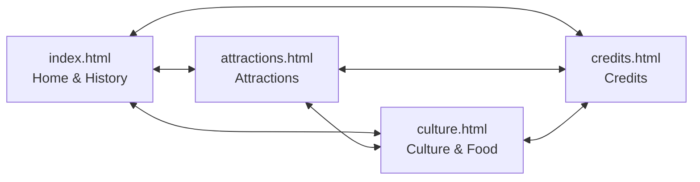

# Manila — Capital City Website · Project Plan

A 4-page, hand-coded (no templates/frameworks) website about **Manila, the capital of the Philippines**, built to satisfy the *Country Website Project* requirements (Gen-AI Planning Activity PDF).

**Decisions so far**

| Topic | Decision |
|---|---|
| Pages | Home & History · Attractions · Culture & Food (with contact form) · Credits |
| Visual style | Heritage / colonial (terracotta, sepia, cream — "Intramuros" feel) with **Philippine-flag accents** (blue, red, sun-gold) |
| Element placement | Chosen by me (see [Page-by-page plan](#page-by-page-plan)) |
| JavaScript | Small vanilla JS **only** for the mobile hamburger menu (progressive enhancement) |
| Fonts | Google Fonts — **Playfair Display** (headings) + **Lato** (body) |
| Repo | You create the public GitHub repo in `...\to-submit\ai-country-website-manila` |

---

## Open Questions

> [!NOTE]
> **Project folder (confirmed):** `C:\Users\Lavi\Desktop\FWD\ai-tools\fwdp-1500-day-02\to-submit\ai-country-website-manila` — the GitHub repo will be created in this same folder. This `plan.md` lives in the project root.

> [!NOTE]
> **Video (confirmed):** a short Creative-Commons clip from Wikimedia Commons (e.g. Manila Bay sunset, Intramuros or jeepneys) in a native `<video>` element, downloaded as an already-web-optimized WebM (a YouTube `<iframe>` would *not* count).

> [!NOTE]
> **Credits links (confirmed):** every reference/credit on `credits.html` must be a clickable, accessible link — see [Accessible credit links](#accessible-credit-links).

---

## Requirements Checklist (from PDF → where it's met)

| Requirement | How / where |
|---|---|
| 3 location pages + 1 credits page | `index.html`, `attractions.html`, `culture.html`, `credits.html` |
| CC-licensed text, images, video | Wikimedia Commons / Openverse assets (`CC BY`, `CC BY-SA`, `CC0`); original/adapted site text explicitly licensed under `CC BY-SA 4.0` |
| Credits specify the **page** each asset is used on + links to creators + AI used | `credits.html`, grouped by page with per-item `"Used on: …"` links (including site-wide items); clickable links to source, creator, licence, and all AI tools/resources used |
| One `<table>` | Quick Facts table — `index.html` |
| Two images (min.) | ~10 images across all pages |
| One `<audio>`/`<video>` | Captioned `<video>` — `attractions.html` |
| One `<blockquote>` | Filipino proverb — `culture.html` |
| One contact form (semantic + accessible, need not work) | "Plan Your Visit" form — `culture.html` |
| Navigation linking every page, reused on all pages | Identical `<header><nav>` on all 4 pages, `aria-current="page"` |
| SEO `<meta name="description">` on each page | Unique description per page |
| Favicon for mobile / tablet / desktop | `.ico` + `.svg` + Apple touch icon + 192/512 PNGs + `site.webmanifest` |
| ≥1 external stylesheet for all pages | `css/styles.css` (+ `css/normalize.css`) |
| CSS Grid ≥1 | Attractions card grid, page layout, footer |
| Flexbox ≥1 | Header/nav, CTA cards, form rows |
| Custom font ≥1 | Playfair Display + Lato |
| Clean, semantic HTML | Landmarks, sections/articles, figure/figcaption, one `<h1>` per page |
| Mobile-first, works 320px → 1920px+ | Base styles = mobile; `min-width` media queries; max-width container |
| Accessibility (skip link, keyboard nav, …) | See [Accessibility](#accessibility) |
| Optimized images/video | WebP + `srcset`, explicit sizes, lazy-loading, compressed WebM, `preload="none"` |
| Public GitHub repo | You create it; I prepare commits + README |
| No templates/frameworks (except normalize/reset) | Only `normalize.css` |

---

## Site Map



All pages share the same header (logo + nav), footer, favicon set, and stylesheet.

---

## File Structure

```
ai-country-website-manila/
├── index.html              # Home & History
├── attractions.html        # Attractions + video
├── culture.html            # Culture & Food + blockquote + contact form
├── credits.html            # Credits / references / AI disclosure
├── plan.md                 # this plan
├── README.md
├── site.webmanifest
├── favicon.ico             # 32×32 (legacy/desktop)
├── favicon.svg             # modern browsers (scales)
├── apple-touch-icon.png    # 180×180 (iOS)
├── icon-192.png            # Android
├── icon-512.png            # Android / PWA splash
├── css/
│   ├── normalize.css
│   └── styles.css
├── js/
│   └── nav.js              # hamburger toggle only
├── images/                 # *.webp at 480 / 960 / 1600 widths
├── media/
│   ├── manila.webm         # (+ .mp4 if available)
│   ├── manila-poster.webp
│   └── manila-captions.vtt
└── tools/                  # git-ignored helper scripts (image/favicon generation)
```

---

## Design System

### Colour palette (heritage base + flag accents)

| Role | Name | Hex | Notes |
|---|---|---|---|
| Background | Cream | `#F5ECD9` | page background |
| Surface | Parchment | `#FBF6EC` | cards, form fields |
| Text | Dark Sepia | `#2B1D14` | body text (≈15:1 on cream) |
| Primary | Terracotta | `#9C4A2F` | headings, links (≈5.2:1 on cream – AA) |
| Secondary | Sepia | `#704214` | borders, footer bg (cream `#F5ECD9` text & links ≈7.2:1; sun-gold `#FCD116` hover accents ≈5.8:1) |
| Accent | Flag Blue | `#0038A8` | focus rings, buttons, active nav (≈8:1) |
| Accent | Flag Red | `#CE1126` | small highlights, required `*` (≈4.8:1) |
| Accent | Sun Gold | `#FCD116` | decorative only (sun motif, underlines on dark bg) — never text on cream |

All values are CSS custom properties in `:root` so the palette is changed in one place.

### Typography

- **Headings:** Playfair Display (700) — classic, colonial-era feel.
- **Body / UI:** Lato (400, 700) — highly legible at small sizes.
- Loaded via Google Fonts with `preconnect` + `display=swap`; fallbacks `Georgia, serif` / `system-ui, sans-serif`.
- Fluid type scale with `clamp()` (e.g. `h1: clamp(2rem, 5vw + 1rem, 4rem)`), base `1rem`/`1.6` line height.

### Motifs

- Philippine-flag **8-ray sun** (SVG) used in the logo, favicon, and as a section divider.
- Thin tri-colour (blue/red/gold) border under the header.
- Sepia-toned photo frames with subtle shadow; rounded 0.5rem corners.

### Breakpoints (mobile-first, `min-width`)

| Name | Query | Layout changes |
|---|---|---|
| Base | < 48em (320–767px) | single column, hamburger menu |
| Tablet | `48em` (768px) | inline nav, 2-column grids |
| Desktop | `64em` (1024px) | 3-column grids, side-by-side text/image |
| Wide | `90em` (1440px)+ | content capped at `75rem` max-width, larger hero |

---

## Shared Page Skeleton

```html
<!DOCTYPE html>
<html lang="en">
<head>
  <meta charset="UTF-8">
  <meta name="viewport" content="width=device-width, initial-scale=1">
  <title>Manila | Pearl of the Orient — Home &amp; History</title>
  <meta name="description" content="Discover Manila, the historic capital of the Philippines: quick facts, a brief history from Maynila to the modern metropolis, and what makes the city unique.">

  <!-- Favicons -->
  <link rel="icon" href="favicon.ico" sizes="32x32">
  <link rel="icon" href="favicon.svg" type="image/svg+xml">
  <link rel="apple-touch-icon" href="apple-touch-icon.png">
  <link rel="manifest" href="site.webmanifest">

  <!-- Fonts -->
  <link rel="preconnect" href="https://fonts.googleapis.com">
  <link rel="preconnect" href="https://fonts.gstatic.com" crossorigin>
  <link rel="stylesheet" href="https://fonts.googleapis.com/css2?family=Lato:wght@400;700&family=Playfair+Display:wght@700&display=swap">

  <link rel="stylesheet" href="css/normalize.css">
  <link rel="stylesheet" href="css/styles.css">
  <script src="js/nav.js" defer></script>
</head>
<body>
  <a class="skip-link" href="#main">Skip to main content</a>

  <header class="site-header">
    <a class="logo" href="index.html"><!-- sun SVG --> Manila</a>
    <nav aria-label="Main">
      <button class="nav-toggle" type="button" aria-expanded="false" aria-controls="nav-menu" hidden>
        <span class="visually-hidden">Menu</span> <!-- hamburger icon -->
      </button>
      <ul id="nav-menu" class="nav-menu">
        <li><a href="index.html" aria-current="page">Home</a></li>
        <li><a href="attractions.html">Attractions</a></li>
        <li><a href="culture.html">Culture &amp; Food</a></li>
        <li><a href="credits.html">Credits</a></li>
      </ul>
    </nav>
  </header>

  <main id="main" tabindex="-1">
    <!-- page content -->
  </main>

  <footer class="site-footer">
    <!-- <nav aria-label="Footer"> mini nav, "Text content licensed under CC BY-SA 4.0" (linked), link to credits, © 2026 -->
  </footer>
</body>
</html>
```

### Hamburger menu (progressive enhancement)

- Without JS: the toggle button stays `hidden` and the nav is simply shown as a stacked list → site fully usable.
- With JS (`js/nav.js`, ~20 lines): un-hides the button, collapses the menu on small screens (`display: none` when closed so hidden links cannot receive keyboard Tab focus), toggles `aria-expanded` + `.is-open`, closes on `Esc`, and returns focus to the button.
- At ≥48em the button is hidden via CSS and the nav is an inline **flex** row.

```js
// js/nav.js (sketch)
const toggle = document.querySelector('.nav-toggle');
const menu = document.getElementById('nav-menu');
toggle.hidden = false;
document.documentElement.classList.add('js');
toggle.addEventListener('click', () => {
  const open = toggle.getAttribute('aria-expanded') === 'true';
  toggle.setAttribute('aria-expanded', String(!open));
  menu.classList.toggle('is-open', !open);
});
document.addEventListener('keydown', (e) => {
  if (e.key === 'Escape' && menu.classList.contains('is-open')) {
    toggle.click();
    toggle.focus();
  }
});
```

---

## Page-by-page plan

### 1. `index.html` — Home & History

**Meta description:** "Discover Manila, the historic capital of the Philippines: quick facts, a brief history from Maynila to the modern metropolis, and what makes the city unique."

| Section | Content | Elements / CSS |
|---|---|---|
| Hero | Manila Bay / skyline photo, `<h1>` "Manila: Pearl of the Orient", tagline | `` with `fetchpriority="high"`, text overlay with dark gradient + solid dark `#2B1D14` fallback `background-color` for deterministic WCAG contrast |
| Introduction | 2–3 short paragraphs: capital since 1571, on Manila Bay at the mouth of the Pasig River, one of the most densely populated cities in the world | — |
| **Quick Facts** | **`<table>`** with `<caption>`, `<thead>` (`<th scope="col">`), and `<tbody>` (`<th scope="row">`): Country · Region (NCR) · Founded (24 June 1571) · Area (≈42.9 km²) · Population (≈1.85 million, 2020 census) · Languages (Filipino, English) · Currency (Philippine peso ₱) · Time zone (PHT, UTC+8) · Nickname | Striped rows, cells wrap cleanly at 320px without horizontal overflow |
| Brief History | Timeline as an ordered list: pre-colonial Maynila (Rajah Sulayman) → 1571 Spanish founding & Intramuros → galleon trade → American period (1898–1946) → 1945 Battle of Manila → modern capital | `<ol>` styled as vertical timeline; Grid with image at ≥64em |
| Explore More | 2 cards linking to Attractions and Culture & Food | **Flexbox** card row (wraps on mobile) |

### 2. `attractions.html` — Attractions

**Meta description:** "Top places to visit in Manila: Intramuros, Fort Santiago, San Agustin Church, Rizal Park, Binondo and more — with photos and a short video tour."

| Section | Content | Elements / CSS |
|---|---|---|
| Page intro | `<h1>` "Must-See Attractions", short intro | — |
| Attractions gallery | 6 `<article>` cards, each `<figure>` + `<h2>` + short text: **Intramuros**, **Fort Santiago**, **San Agustin Church** (UNESCO World Heritage), **Manila Cathedral**, **Rizal Park (Luneta)**, **Binondo** (world's oldest Chinatown, est. 1594); optional: National Museum of Fine Arts, Manila Bay sunset | **CSS Grid** `repeat(auto-fit, minmax(min(100%, 18rem), 1fr))` → 1 / 2 / 3 columns |
| **Video** | "Manila in Motion" — short CC clip | **`<video controls preload="none" width="1280" height="720" poster="…">`** (`aspect-ratio: 16 / 9`) with WebM + MP4 `<source>`s, `<track kind="captions" srclang="en" label="English" default>`, fallback link; no autoplay |
| Visitor tip box | `<aside>` with practical tips (best time to visit: Dec–Feb dry season, getting around by jeepney/LRT) | Accent left border in flag blue |
| Next Stop | Journey cards linking to **Culture & Food →** (and **← Home & History**) | Reuses `.explore-cards` **Flexbox** row component |

### 3. `culture.html` — Culture & Food (+ contact form)

**Meta description:** "Experience Manila's culture and cuisine: festivals like the Feast of the Black Nazarene, the iconic jeepney, and must-try Filipino dishes. Contact us to plan your visit."

| Section | Content | Elements / CSS |
|---|---|---|
| Page intro | `<h1>` "Culture & Food" | — |
| Festivals & Traditions | Feast of the Black Nazarene (Quiapo, 9 January), `<span lang="tl">Simbang Gabi</span>` & long Filipino Christmas season, Independence Day (12 June) | Image + text, Grid side-by-side at ≥64em; `lang="tl"` on Tagalog phrases |
| Jeepney — King of the Road | History of the jeepney from WWII army jeeps, cultural symbol | Image |
| **Blockquote** | Filipino proverb (`<p lang="tl">`): *"Ang hindi lumingon sa pinanggalingan ay hindi makararating sa paroroonan."* — followed by English translation: "One who does not look back at where they came from will never reach their destination." | **`<blockquote>`** + `<figcaption>`/`<cite>` inside `<figure>`; `lang="tl"` on Tagalog quote; decorative sun-gold quote mark |
| Must-Try Foods | Adobo, sinigang, lechon, halo-halo, Binondo street food (siopao, hopia, lumpia) | `<ul>` of food cards (**Flexbox** wrap) or definition list, 1–2 food photos |
| **Contact form** | "Plan Your Visit" | See below |
| Next Stop | Journey cards linking to **Credits & Sources →** (and **← Attractions**) | Reuses `.explore-cards` **Flexbox** row component |

**Contact form (non-functional, semantic & accessible):**

```html
<section aria-labelledby="contact-heading">
  <h2 id="contact-heading">Plan Your Visit</h2>
  <p>Fields marked with <span class="required-mark">*</span> are required. (Educational demo form — no data is sent.)</p>
  <form action="#contact-heading" method="get">
    <div class="form-row">
      <label for="name">Full name <span class="required-mark" aria-hidden="true">*</span></label>
      <input id="name" name="name" type="text" autocomplete="name" required>
    </div>
    <div class="form-row">
      <label for="email">Email <span class="required-mark" aria-hidden="true">*</span></label>
      <input id="email" name="email" type="email" autocomplete="email" required>
    </div>
    <div class="form-row">
      <label for="topic">Topic</label>
      <select id="topic" name="topic">
        <option value="general">General question</option>
        <option value="travel-tips">Travel tips</option>
        <option value="food">Food recommendations</option>
      </select>
    </div>
    <fieldset>
      <legend>When are you planning to visit?</legend>
      <!-- radio buttons: Dec–Feb / Mar–May / Jun–Nov / Not sure, each with a <label> -->
    </fieldset>
    <div class="form-row">
      <label for="message">Message <span class="required-mark" aria-hidden="true">*</span></label>
      <textarea id="message" name="message" rows="5" required></textarea>
    </div>
    <button type="submit">Send message</button>
  </form>
</section>
```

Styling: large tap targets (≥44px), visible `:focus-visible` ring in flag blue, `:user-invalid` styling, 2-column name/email layout at ≥48em using **Flexbox**/Grid.

### 4. `credits.html` — Credits & References

**Meta description:** "Credits and references for the Manila website: photo, video, font and text sources with creators, licences, and the AI tools used in planning and building the site."

- `<h1>` "Credits & References"
- One `<section aria-labelledby="…">` **per page** (Home, Attractions, Culture & Food, Site-wide & Text References), each with an `<h2>` and a `<ul>` of credits.
- **Every individual credit specifies the page(s) it is used on** (including Site-wide and fact-reference items, e.g., `Used on: All pages (Home, Attractions, Culture & Food, Credits)`), with internal links to those pages.
- **Every credit is clickable**: links to (1) the asset/source page, (2) the creator's profile or website, and (3) the licence deed.
- **Text licence & fact references:** explicit statement licensing the site's written/adapted text under **CC BY-SA 4.0** (linked to the Creative Commons deed), plus links to factual sources (e.g. Philippine Statistics Authority, UNESCO World Heritage, Wikipedia — CC BY-SA) specifying which page uses each reference.
- **Site-wide:** Google Fonts (Playfair Display, Lato — SIL OFL), normalize.css (MIT), favicon (original artwork under CC BY-SA 4.0) — each specifying `Used on: All pages`.
- **AI disclosure:** "Planning, review, and coding assisted by Google Antigravity (using Claude Opus and Gemini models)", with clickable links to Google Antigravity, model documentation, and any AI chat/resources used.
- Optional decorative image so the page doesn't feel empty (also credited with `Used on: Credits page`).

#### Accessible credit links

Example credit entry:

```html
<p class="credits-note">External links open in a new tab.</p>

<section aria-labelledby="credits-attractions">
  <h2 id="credits-attractions">Attractions page</h2>
  <ul class="credit-list">
    <li>
      <a href="https://commons.wikimedia.org/wiki/File:…" target="_blank" rel="noopener noreferrer">
        Photo of the Intramuros walls<span class="visually-hidden"> (opens in a new tab)</span><span class="external-icon" aria-hidden="true">↗</span>
      </a>
      by
      <a href="https://commons.wikimedia.org/wiki/User:…" target="_blank" rel="noopener noreferrer">
        Creator Name<span class="visually-hidden"> (opens in a new tab)</span><span class="external-icon" aria-hidden="true">↗</span>
      </a>,
      licensed under
      <a href="https://creativecommons.org/licenses/by-sa/4.0/" target="_blank" rel="noopener noreferrer">
        CC BY-SA 4.0<span class="visually-hidden"> (opens in a new tab)</span><span class="external-icon" aria-hidden="true">↗</span>
      </a>.
      <span class="credit-page">Used on: <a href="attractions.html">Attractions page</a> (Intramuros card)</span>
    </li>
  </ul>
</section>
```

```css
/* visible "new tab" cue inside every external link (avoids CSS content alt-text validator errors) */
.external-icon {
  display: inline-block;
  margin-inline-start: 0.2em;
  font-size: 0.8em;
}
/* screen readers skip aria-hidden="true" on ↗ and read the visually-hidden "(opens in a new tab)" text */
```

Rules applied to **all** credit/reference links:

- **Descriptive link text** that makes sense out of context (e.g. "Photo of the Intramuros walls", "CC BY-SA 4.0", the creator's name) — never "click here", "link", or a bare URL.
- **Real `<a href>` elements** to the exact source → keyboard focusable (Tab) and activated with Enter, announced as links by screen readers.
- **External links open in a new tab** (`target="_blank"`) so users can easily return to the Manila site. To keep this accessible, W3C-valid, and safe:
  - a short note at the top of the page: "External links open in a new tab.";
  - visually-hidden text "(opens in a new tab)" inside each link, so screen-reader users are warned before activating it;
  - an inline `<span class="external-icon" aria-hidden="true">↗</span>` inside each external link as a visual cue for sighted users (passes W3C CSS Validator with 0 errors);
  - `rel="noopener noreferrer"` on every new-tab link for security/privacy.
- **Internal links** (e.g. "Used on: Attractions page") stay in the **same tab**.
- **Visually distinguishable**: underlined (not colour alone), link colour ≥ 4.5:1 contrast (terracotta `#9C4A2F` on cream ≈ 5.2:1), distinct `:hover` and `:visited` states.
- **Clear `:focus-visible` ring** (flag blue, 3px, offset) — same as the rest of the site.
- **Long URLs/names wrap** (`overflow-wrap: anywhere`) so nothing breaks the layout at 320px.
- **Adequate tap spacing** between adjacent links in a credit (line-height ≥ 1.6, list-item spacing) for touch users.
- The "Used on:" label links to that page in the same tab (e.g. `<a href="attractions.html">Attractions page</a>`).

---

## Wireframes (rough)

**Mobile (320–767px)** — all pages

```
┌───────────────────────┐
│ ☀ Manila         [≡]  │  ← header (flex), hamburger
├───────────────────────┤
│      HERO IMAGE       │
│   H1 + tagline        │
├───────────────────────┤
│ Section text          │
│ [ image ]             │
│ [ card ]              │  ← grids collapse to 1 column
│ [ card ]              │
├───────────────────────┤
│ footer: nav · credits │
└───────────────────────┘
```

**Desktop (≥1024px)** — Home page (`index.html`)

```
┌──────────────────────────────────────────────┐
│ ☀ Manila     Home  Attractions  Culture  Credits │
├──────────────────────────────────────────────┤
│           HERO IMAGE + H1 + tagline          │
├──────────────────────────────────────────────┤
│ Intro paragraphs    │ ┌──── Quick Facts ───┐ │
│                     │ │ <table>            │ │
│                     │ └────────────────────┘ │
│ Brief History (<ol> │ ┌─── History photo ──┐ │
│ timeline)           │ └────────────────────┘ │
│ ┌── Explore: Attractions ──┐ ┌── Culture ──┐ │
│ └──────────────────────────┘ └─────────────┘ │
├──────────────────────────────────────────────┤
│ footer                                       │
└──────────────────────────────────────────────┘
```

**Desktop (≥1024px)** — Attractions page (`attractions.html`)

```
┌──────────────────────────────────────────────┐
│ ☀ Manila     Home  Attractions  Culture  Credits │
├──────────────────────────────────────────────┤
│ H1 Must-See Attractions · intro              │
│ ┌────────┐ ┌────────┐ ┌────────┐             │
│ │ card   │ │ card   │ │ card   │  ← Grid 3col │
│ └────────┘ └────────┘ └────────┘             │
│ ┌────────┐ ┌────────┐ ┌────────┐             │
│ │ card   │ │ card   │ │ card   │             │
│ └────────┘ └────────┘ └────────┘             │
│ ┌──────────── VIDEO ────────────┐ ┌─ tips ─┐ │
│ └───────────────────────────────┘ └────────┘ │
│ ┌── ← Home & History ──┐ ┌─ Culture & Food →┐ │
│ └──────────────────────┘ └──────────────────┘ │
├──────────────────────────────────────────────┤
│ footer                                       │
└──────────────────────────────────────────────┘
```

**Desktop (≥1024px)** — Culture & Food page (`culture.html`)

```
┌──────────────────────────────────────────────┐
│ ☀ Manila     Home  Attractions  Culture  Credits │
├──────────────────────────────────────────────┤
│ H1 Culture & Food                            │
│ Festivals text          │ [ Festival image ] │
│ [ Jeepney image ]       │ Jeepney history    │
│      ❝ Filipino Proverb <blockquote> ❞       │
│ ┌─ Dish ─┐ ┌─ Dish ─┐ ┌─ Dish ─┐  ← Flex row │
│ └────────┘ └────────┘ └────────┘             │
│ ┌─────── Plan Your Visit <form> ───────────┐ │
│ │ [ Name ]          [ Email ]              │ │
│ │ [ Topic ]  (•) Visit season              │ │
│ │ [ Message ]                 [ Send btn ] │ │
│ └──────────────────────────────────────────┘ │
│ ┌── ← Attractions ────┐ ┌─ Credits & Refs →┐ │
│ └─────────────────────┘ └──────────────────┘ │
├──────────────────────────────────────────────┤
│ footer                                       │
└──────────────────────────────────────────────┘
```

**Desktop (≥1024px)** — Credits page (`credits.html`)

```
┌──────────────────────────────────────────────┐
│ ☀ Manila     Home  Attractions  Culture  Credits │
├──────────────────────────────────────────────┤
│ H1 Credits & References · new-tab note       │
│ ┌─ Home credits ─┐ ┌─ Attractions credits ─┐ │
│ └────────────────┘ └───────────────────────┘ │
│ ┌─ Culture & Food ─┐ ┌─ Site-wide & AI ────┐ │
│ └──────────────────┘ └─────────────────────┘ │
├──────────────────────────────────────────────┤
│ footer                                       │
└──────────────────────────────────────────────┘
```

---

## Accessibility

- Skip-to-content link (first focusable element, visible on focus).
- Landmarks: `header`, `nav[aria-label]`, `main#main`, `footer`; logical heading order, one `<h1>` per page.
- `aria-current="page"` on the active nav link.
- Full keyboard support: all interactive elements are native (`a`, `button`, form controls); hamburger has `aria-expanded`/`aria-controls`, `Esc` closes.
- Visible `:focus-visible` outlines (flag blue, 3px offset).
- Meaningful `alt` text on content images; `alt=""` on decorative ones; SVG icons `aria-hidden="true"`.
- Colour contrast ≥ 4.5:1 for text (palette checked above); gold never used for text on light backgrounds.
- Video: captions `<track>`, controls, no autoplay.
- Form: every input has a `<label>`, radio group in `<fieldset>/<legend>`, `required`, `autocomplete`.
- Language of parts (WCAG 3.1.2): `lang="tl"` on Tagalog phrases and the Filipino proverb `<blockquote>` so screen readers use proper Tagalog pronunciation.
- `@media (prefers-reduced-motion: reduce)` disables transitions/smooth scroll.
- Text resizes to 200% without loss (rem units, no fixed heights).

## Performance & Asset Optimization

- **Images:** sourced from Wikimedia Commons / Openverse under explicit Creative Commons licences (`CC BY`, `CC BY-SA`, `CC0`), resized to 480 / 960 / 1600px and converted to **WebP** (quality ~75) using a small Node script with `sharp` in `tools/` (git-ignored). `srcset` + `sizes`, explicit `width`/`height` (no layout shift), `loading="lazy"` + `decoding="async"` except the hero.
- **Video:** Wikimedia Commons' pre-transcoded 480p/720p WebM + MP4 fallback (small file, ≤ ~30–60s clip), `preload="none"`, explicit dimensions, WebP poster image.
- **Favicons:** generated from one `favicon.svg` (Philippine sun) with `sharp` → `apple-touch-icon.png` (180), `icon-192.png`, `icon-512.png`, `favicon.ico` (32). `site.webmanifest` uses relative paths (`./icon-192.png`, `./index.html`) so icons work both locally and on GitHub Pages project URLs.
- Only 2 font families, limited weights; `display=swap`.
- One CSS file + normalize; tiny deferred JS file.

---

## Implementation Steps

1. **Set up project** — create folder, `git init`, `.gitignore` (`node_modules/`, `tools/node_modules/`), add `normalize.css`, empty pages from the shared skeleton.
2. **Source & credit assets** — pick ~10 CC images + 1 video from Wikimedia Commons; record creator, licence, URL and target page in a credits list *as I go*.
3. **Optimize assets** — resize/convert images, create favicon set + manifest, write captions `.vtt`.
4. **Build `styles.css`** — custom properties, base/mobile styles, header/nav, footer, components (cards, table, timeline, blockquote, form), then tablet/desktop/wide media queries.
5. **Write the pages** — Home → Attractions → Culture & Food → Credits, with original text licensed under CC BY-SA 4.0.
6. **Add `nav.js`** — hamburger with progressive enhancement.
7. **Verify** (see below, served over a local HTTP server such as `npx serve .` so `.vtt` `<track>` captions and Lighthouse run cleanly), fix issues.
8. **README + commits** — README with project description, page list, and how requirements are met; meaningful commit history ready for you to push to your public GitHub repo.

---

## Verification Plan

### Automated checks
- **HTML validation:** `npx.cmd html-validate *.html` locally, plus W3C Nu validator (https://validator.w3.org/nu/) for each page — 0 errors.
- **CSS validation:** W3C CSS validator (https://jigsaw.w3.org/css-validator/) — 0 errors.
- **Lighthouse** (Chrome DevTools) on each page — target ≥ 90 for Accessibility, Best Practices, SEO and Performance.
- **Link check:** every nav/footer/credit link resolves (no 404s, all local assets load).

### Manual / browser checks
- Responsive screenshots at **320, 375, 768, 1024, 1440, 1920px** for all 4 pages — no horizontal scroll, readable layout.
- **Keyboard-only walkthrough:** Tab from skip link → nav → content → form → footer; hamburger opens/closes with Enter/Space/Esc; focus always visible.
- Video plays, captions show; form shows native validation on empty submit.
- **Credits page:** Tab through every credit link — each is focusable with a visible focus ring, has descriptive text, and opens the correct source/creator/licence page **in a new tab** (with the ↗ icon and screen-reader "opens in a new tab" text present).
- Favicon appears in browser tab; Apple touch icon/manifest referenced correctly.
- Final pass against the [Requirements Checklist](#requirements-checklist-from-pdf--where-its-met), ticking each item.

### What you'll need to do
- Create the **public GitHub repo** and push (I can give you the exact commands); optionally enable GitHub Pages for a live URL.
